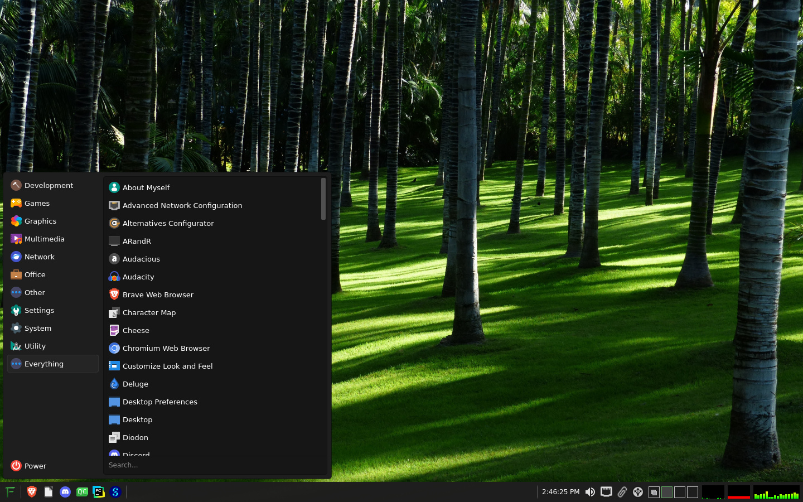

# Forest

Forest is a lightweight desktop environment for Linux built with C++ and Qt. It has a modular design and is fully themeable via QSS (Qt style sheets).

It requires the [Biome](https://github.com/nicholasyoder/biome) Wayland compositor (or another compositor speaking the same protocols) — Forest's shell is Wayland-native and will not work correctly under X11.



## Installation

### Fedora

Forest targets Fedora 45 (Qt 6.11). Download the latest RPMs from the
[releases page](https://github.com/nicholasyoder/forest/releases), along with the
[Biome](https://github.com/nicholasyoder/biome/releases) RPM, and install them together:

```sh
sudo dnf install ./biome-*.rpm ./forest-0*.rpm ./forest-greeter-*.rpm
```

`forest-greeter` is optional (login screen only).

### Debian (no longer fully supported)

Forest now targets Fedora. The last prebuilt `.deb` packages are from the
[0.10.0 release](https://github.com/nicholasyoder/forest/releases/tag/v0.10.0) (Debian 13 "Trixie"); new releases
won't have prebuilt `.deb`s. `debian/` is kept for now but is untested, and Biome
0.2.1+ needs wlroots 0.20, which Trixie doesn't have, so a current Forest `.deb` won't
install there. To install 0.10.0:

```sh
sudo apt install ./forest_*.deb
```

By default apt also installs recommended packages, and some of Forest's dependencies recommend parts of LXQt. Most notably, `pcmanfm-qt` pulls in `lxqt-session`, which adds an LXQt entry to the login screen. To install only what Forest needs, add `--no-install-recommends`:

```sh
sudo apt install --no-install-recommends ./biome_*.deb ./forest_*.deb ./forest-greeter_*.deb
```

### Greeter (login screen)

The `forest-greeter` package installs `greetd` and a config pointing it at Forest's
greeter, but does **not** enable or start `greetd.service` automatically — this avoids
conflicting with any display manager you may already have enabled. If you want to use
the Forest greeter as your login screen, disable any existing display manager and
enable greetd yourself:

```sh
sudo systemctl disable --now <existing-display-manager>.service
sudo systemctl enable --now greetd.service
```

greetd is started by `graphical.target`, so on a system that boots to
`multi-user.target` (e.g. a Fedora Server or minimal install) also run
`sudo systemctl set-default graphical.target`, or it will still boot to a text login.

## Building from Source

**Dependencies Include:** CMake, Qt6, LayerShellQt, Qt6Xdg, libXcursor, xkbcommon, ALSA, libsensors, PAM

On Fedora 45:

```sh
sudo dnf builddep packaging/forest.spec
```

or, without the spec:

```sh
sudo dnf install gcc-c++ cmake pkgconf-pkg-config qt6-qtbase-devel qt6-qtbase-private-devel \
  qt6-qtwayland-devel layer-shell-qt-devel libdbusmenu-lxqt-devel polkit-qt6-1-devel \
  libqtxdg-devel libXcursor-devel alsa-lib-devel lm_sensors-devel pam-devel \
  libxkbcommon-devel wayland-devel wayland-protocols-devel
```

Other distros aren't tested; Debian 13 (Trixie) built Forest through 0.10.0.

```sh
cmake -B build
cmake --build build
sudo cmake --install build
```

## Packaging

### RPM (Fedora)

```sh
sudo dnf install rpm-build rpmdevtools           # once
sudo dnf builddep packaging/forest.spec          # once: installs the spec's BuildRequires
mkdir -p rpmbuild/SOURCES
git archive --prefix=forest-0.10.1/ -o rpmbuild/SOURCES/forest-0.10.1.tar.gz HEAD   # stands in for the release tarball the spec expects
rpmbuild -ba --define "_topdir $PWD/rpmbuild" packaging/forest.spec
```

Run from the repo root; output lands in `rpmbuild/RPMS/` (gitignored) as `forest` and
`forest-greeter` (plus debuginfo). To use the default `~/rpmbuild` instead, drop the
`--define`, use `~/rpmbuild/SOURCES` for the tarball, and run `rpmdev-setuptree` once.
For a clean-chroot build, run `mock -r fedora-45-x86_64` on the resulting `.src.rpm`.
`forest` requires `biome >= 0.2.1`, so install the Biome RPM first or in the same command.
Keep the spec's `Version` in step with `CMakeLists.txt`, and regenerate its `%changelog`
from `docs/changelog.md` with `docs/convert-changelog-rpm.sh` at each release.

### Debian (no longer fully supported)

`debian/` is kept for now but is untested, and no `.deb`s are published for new releases. Debian packages can be built from `debian/` with:

```sh
sudo apt build-dep .            # once: installs debian/control's Build-Depends
dpkg-buildpackage -us -uc -b    # or `debuild -us -uc` (devscripts) to also run lintian
```

This produces `../forest_<version>_amd64.deb` and `../forest-greeter_<version>_amd64.deb` (plus a `-dbgsym` package for each); it doesn't install anything locally. The version comes from the top entry of `debian/changelog`. For cutting a release, see [docs/development-notes.md](docs/development-notes.md#release-packaging).

It builds the working tree as-is, uncommitted changes included.

`forest` depends on `biome`, so on a fresh system install the [Biome](https://github.com/nicholasyoder/biome) `.deb` first or in the same command.

It leaves build byproducts in the tree (`obj-*-linux-gnu/`, `debian/forest/`, `debian/forest-greeter/`, etc., all gitignored). Remove them with:

```sh
dpkg-buildpackage -Tclean
```
